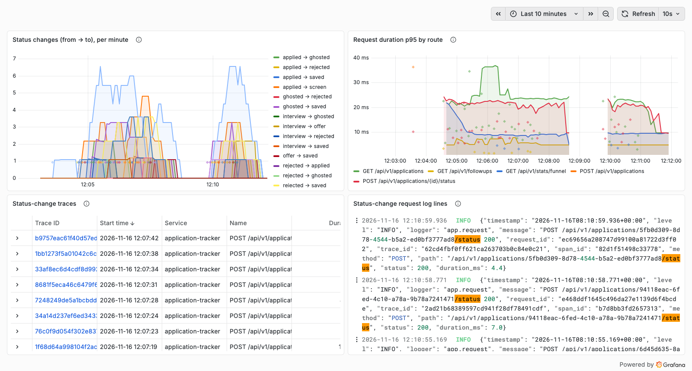
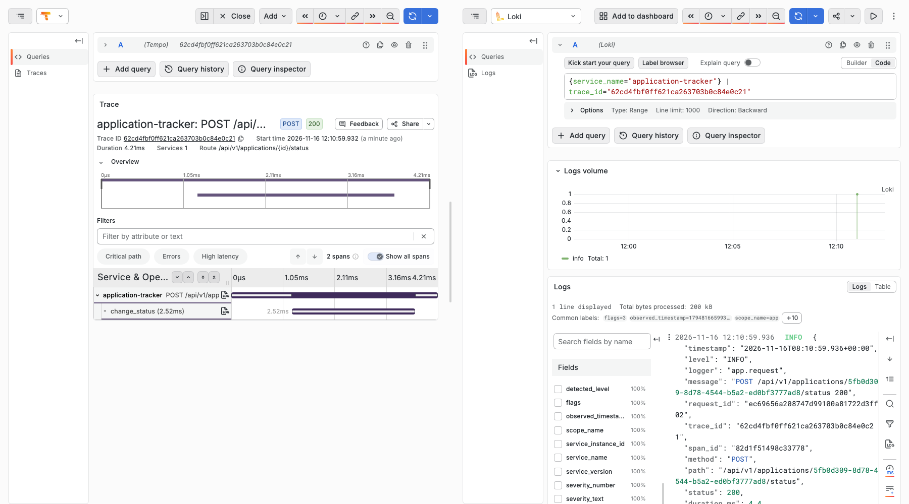

# Application Tracker

A single-user web app for tracking job applications through stages, with automatic follow-up dates
and funnel numbers. Final project for [AI Dev Tools Zoomcamp 2026](https://github.com/DataTalksClub/ai-dev-tools-zoomcamp).

**Live app:** https://application-tracker-kvn5.onrender.com (free tier: it sleeps after 15 minutes idle, so the first request takes about a minute)

## The problem

A job search run from a spreadsheet loses two things:

- **Follow-ups slip.** Nothing tells you that an application has been quiet for a week and deserves a
  nudge.
- **You can't tell which channel works.** A spreadsheet keeps the current status only. Once an
  application is "rejected", you no longer know whether it got as far as a screening call, so you
  can't compare cold applications with referrals or recruiter inbound.

## What the app does

- Keeps a list of applications: company, role, link, source (`cold`, `inbound`, `referral`), status,
  applied date, next follow-up date and notes. Filter the list by status.
- Moves an application through `saved → applied → screen → interview → offer`, or out to `rejected` /
  `ghosted`, with an optional note. Every change is recorded and shown as a history.
- Sets dates by itself: marking an application **applied** sets the applied date (if empty) and a
  follow-up 7 days later; **offer**, **rejected** or **ghosted** clear the follow-up.
- Shows a **Follow-ups** list: everything still in play (`applied`, `screen`, `interview`) whose
  follow-up date is today or earlier.
- Shows a **Funnel**: how many applications are in each status, and per source the share of applied
  applications that reached a screening call. An application counts as having reached screen if its
  history ever moved it to `screen` or later, even if it was rejected afterwards.

The full spec, with the data model, rules and API, is in [`_docs/specs.md`](_docs/specs.md).

### Expected behaviour, by example

1. Add "Example Robotics, Data Engineer, source: referral". It starts as `saved`, with one history
   entry.
2. Move it to `applied` on 14 Nov. Applied date becomes 14 Nov, follow-up 21 Nov.
3. On 21 Nov it shows up in **Follow-ups**. Move it to `screen`; it stays in Follow-ups until you
   change the date or the status.
4. Move it to `rejected`. The follow-up date is cleared, so it leaves Follow-ups. In **Funnel** it
   still counts for `referral` as applied *and* reached screen.
5. Moving an application to the status it already has is refused (`409 invalid_transition`); a bad
   field gets a readable message (`422 validation_error`).

## Run it

Needs Docker only:

```sh
docker compose up --build
```

Then open <http://localhost:8080>. Compose starts PostgreSQL 16 and the app, runs the migrations, and
seeds about ten invented applications so there is something to look at. `docker compose down` keeps
the data; `docker compose down -v` deletes it.

Compose publishes two host ports, and `docker compose up` fails if either is already taken:

| Variable | Default | What | If it is taken |
| --- | --- | --- | --- |
| `APP_PORT` | 8080 | the app | `APP_PORT=8090 docker compose up`, then open <http://localhost:8090> |
| `POSTGRES_PORT` | 5432 | PostgreSQL, on 127.0.0.1 only (for `psql` and `make test-integration`) | `POSTGRES_PORT=5433 docker compose up`; the app is still on <http://localhost:8080> |

A local PostgreSQL or another Compose stack usually holds 5432. Both can be set at once
(`APP_PORT=8090 POSTGRES_PORT=5433 docker compose up`), or in a `.env` file (see
[`.env.example`](.env.example)).

For development (needs [uv](https://docs.astral.sh/uv/) and Node.js 22):

```sh
make install   # backend and frontend dependencies
make dev       # API on :8000 (SQLite), UI on :5173 with hot reload
make test      # every test suite (needs Docker for the PostgreSQL tests)
make           # list every target
```

API docs (Swagger) are at `/docs` on a running API; the contract is [`openapi.yaml`](openapi.yaml).

## Stack and architecture

| Part | Choice |
| --- | --- |
| Backend | Python 3.14, FastAPI, Pydantic v2, SQLAlchemy 2.0, Alembic, uv |
| Database | PostgreSQL 16 (Compose, production); SQLite for the fast API tests |
| Frontend | React 19, TypeScript, Vite; no router or UI library |
| Container | one multi-stage [`Dockerfile`](Dockerfile): Node builds the UI, a slim Python image (non-root) serves the API and the built UI |
| Observability | JSON logs; OpenTelemetry SDK and FastAPI instrumentation, exported only when `OTEL_EXPORTER_OTLP_ENDPOINT` is set; a local Collector, Prometheus, Tempo, Loki and Grafana (Compose profile `observability`) |
| CI/CD | GitHub Actions ([`ci.yml`](.github/workflows/ci.yml), [`smoke.yml`](.github/workflows/smoke.yml)), Render |

```text
browser ──▶ FastAPI ──┬─ /            built React app (static files)
                      ├─ /api/v1/*    api/ → services/ → repositories/ ──▶ PostgreSQL
                      └─ /health, /ready
```

- `api/` maps HTTP to calls; `services/` holds the rules as pure functions that take "today" as an
  argument; `repositories/` is the only code that touches SQL.
- A status change and its history event are written in one transaction.
- Every error is `{"error": {"code", "message", "details"}}`.
- Schema changes go through Alembic; the app migrates on start.

## Tests

`make test` runs five suites; CI runs the same ones on every pull request.

| Suite | Where | What it covers | Count |
| --- | --- | --- | --- |
| Unit | `backend/tests/unit` | date rules, follow-up rule, funnel maths, config, log format, the observability files (Compose profile, Grafana provisioning); no database | 144 |
| API | `backend/tests/api` | every endpoint through FastAPI's TestClient on SQLite, every acceptance criterion by id, the routes against `openapi.yaml`, telemetry through in-memory OpenTelemetry exporters | 265 |
| Integration | `backend/tests/integration` | migrations up and down on PostgreSQL, the full flow (create → status changes → history → follow-ups → funnel), cascades, UTC timestamps, hidden SQL parameters | 10 |
| Frontend | `frontend/src/**/*.test.ts` | the typed API client, routing, formatting and overdue helpers (vitest) | 63 |
| Scripts | `scripts/responder/tests/run.sh` | the on-call responder and the Smoke hand-off, with a fake `gh` and a stub model | 65 |

The integration tests start a throwaway `postgres:16` with testcontainers, or use `TEST_DATABASE_URL`
when it is set (CI uses a Postgres service container).

## CI/CD

[`ci.yml`](.github/workflows/ci.yml) runs on every pull request and every push to `main`:

1. `backend`: ruff, format check, mypy (strict), unit and API tests.
2. `frontend`: typecheck, vitest, production build.
3. `integration`: the PostgreSQL tests against a service container.
4. `scripts`: the responder and Smoke script tests, shellcheck and actionlint.
5. `docker`: builds the production image.
6. `deploy-dev`: on `main` only, and only when 1–5 passed. Calls the dev service's Render deploy hook
   for that commit and waits until the dev `/health` reports the commit SHA.
7. `deploy-prod`: after `deploy-dev`, and only once a reviewer approves the `production` environment.
   Calls the prod deploy hook for the same commit and waits until the live `/health` reports it. A
   failing test means no deploy, and the running version stays up. See [Dev and prod](#dev-and-prod).

To go back to an earlier version, run the manual [Rollback](#rollback) workflow
([`rollback.yml`](.github/workflows/rollback.yml)).

Every change after CI existed went through a pull request with green checks
([closed pull requests](https://github.com/iLoveCmajor/application-tracker/pulls?q=is%3Apr+is%3Aclosed)).
PR #14 is a deliberately broken test that shows CI going red.

## Observability and alerting

**What production exports: nothing.** The deployed app on Render runs with OpenTelemetry off:
[`render.yaml`](render.yaml) sets no `OTEL_EXPORTER_OTLP_ENDPOINT`, and no hosted telemetry backend
is connected. In production you get the JSON logs in Render's log view, `/health` and `/ready`, and the
hourly Smoke check. The metric → trace → log view with `trace_id` (Grafana, Tempo, Loki, Prometheus)
exists only in the local Compose stack ([below](#following-a-request-across-metrics-traces-and-logs)).
Sending telemetry from Render to a hosted backend is not done.

- **Logs.** One JSON object per line on stdout, viewable in Render's log view: timestamp, level,
  message, request id, method, path, status, duration. The request id comes from `X-Request-ID` or is
  generated, and is returned in that header, so a user's report can be matched to its log line.
  Request bodies, query strings and application fields are never logged. An unhandled error logs one
  ERROR line with the request id and the traceback; the user gets a plain 500 without it.
- **Health.** `/health` says the process is up and which commit it runs; `/ready` says the database
  answers (503 if not). Render uses `/ready` as its health check.
- **Alert on user impact.** [`smoke.yml`](.github/workflows/smoke.yml) runs every hour against the
  public URL and checks what a user needs: the app is up, the database answers, and the funnel page's
  API returns data. It retries for up to four minutes so a sleeping free instance can wake. On
  failure it opens a GitHub issue labelled
  [`alert`](https://github.com/iLoveCmajor/application-tracker/issues?q=label%3Aalert), or comments on
  the one already open.
- **Traces, metrics and logs (OpenTelemetry, local only).** The status-change journey
  (`POST /api/v1/applications/{id}/status`) is instrumented: every request gets a server span, a status
  change gets a `change_status` child span (application id, `from` and `to` status), a counter
  `app_status_changes_total{from, to}` counts committed changes (a 409 or 404 adds nothing), and the
  HTTP histogram `http_server_request_duration_seconds` measures every route. Each JSON log line then
  also carries `trace_id` and `span_id`. Telemetry is on only when `OTEL_EXPORTER_OTLP_ENDPOINT` is
  set ([`.env.example`](.env.example)); without it nothing is set up and nothing is sent, which is how
  production on Render runs.

### Following a request across metrics, traces and logs

```sh
docker compose --profile observability up --build
```

This starts db and app plus an OpenTelemetry Collector, Prometheus, Tempo, Loki and Grafana
(config in [`docker/observability/`](docker/observability)); plain `docker compose up` still starts only
db and app. Under the profile the app finds the collector and sets
`OTEL_EXPORTER_OTLP_ENDPOINT=http://otel-collector:4318` itself. It sends all three signals over
OTLP/HTTP to the collector, which forwards traces to Tempo, metrics to Prometheus (its OTLP receiver,
with exemplars) and logs to Loki (its OTLP endpoint). The logs in Loki are the same JSON lines the app
writes to stdout, with `trace_id` and `span_id` also stored as Loki structured metadata.

Open Grafana at <http://localhost:3000> (no login; ports bound to 127.0.0.1, change them with
`GRAFANA_PORT`, `PROMETHEUS_PORT`, `TEMPO_PORT`, `LOKI_PORT`). The data sources and the
**Application Tracker: status changes** dashboard are provisioned. Change a status in the app, then:

1. **Metric → trace.** In *Status changes (from → to)*, hover an exemplar dot on the line and click
   **View trace** (or click a trace id in *Status-change traces*).
2. **Trace → logs.** The trace has the `POST /api/v1/applications/{id}/status` server span and its
   `change_status` child. On a span, **Logs for this span** opens the Loki lines with that `trace_id`.
3. **Log → trace.** In *Status-change request log lines*, expand a line: the `trace_id` field has a
   **View trace** link back to Tempo.





No application fields or credentials reach any signal. The app exports only allowlisted span
attributes (method, route, status code, application id, from/to status), keeps an exception event's
type but not its message, exports only the two metrics above with only their listed labels, and
never records request bodies, query strings, client addresses or SQL. The log lines are the #12 lines,
which carry none of them either. Health checks (`/health`, `/ready`) are not traced.
Seed data at start-up goes through the same status-change code, so the counter starts above zero.

### On-call responder

[`responder.yml`](.github/workflows/responder.yml) answers an alert first: a script collects the
evidence, Claude Code (headless) diagnoses it and may edit code, and the workflow, not the model,
checks the change, posts the diagnosis and opens a pull request for a fix that passes its tests.
The scripts are in [`scripts/responder/`](scripts/responder).

- **Trigger.** Smoke starts it with `gh workflow run` when it opens a new alert (an issue opened
  with `GITHUB_TOKEN` fires no `issues` event; a dispatch does). A person adding the `alert` label
  to an issue, or opening one with it, starts it too. Comments, edits, other labels, pull requests
  and repeat failures on an open alert don't; to run it again, remove and re-add the label. Its own
  comments and pull requests can't start it: they're made with `GITHUB_TOKEN`, and it never adds a
  label. One run per alert at a time.
- **Evidence before the model.** `collect-evidence.sh` gathers the alert issue, status and body of
  the live `/health`, `/ready` and `/api/v1/stats/funnel`, the failed Smoke run's log, the deployed
  version against `main`, and the last ten commits. Each part is capped at 4 KB and the packet at
  24 KB; credential-shaped strings are masked. An unreachable app still gives a packet ("no
  response").
- **What the model may do.** Read, search and edit files in the checkout (`Read`, `Grep`, `Glob`,
  `Edit`, `Write`), nothing else: no shell, so it can't run code that reads its key or reaches the
  network; no web tools, no MCP servers, no `gh`, no `git`. It runs with an environment of `PATH`,
  `HOME` and `ANTHROPIC_API_KEY` only, in a checkout with no stored credentials, with a $3 budget
  cap. It answers with JSON: `category` (`code`, `infra`, `unknown`), `cause`, `summary`, `fix`,
  `human_action`.
- **What code decides.** `verify.sh` allows a pull request only when the category is `code`, the app
  answered at all, the changed files are all under `backend/src/`, `backend/tests/` or
  `frontend/src/`, and the tests pass (ruff and the backend unit and API tests; vitest when the
  frontend changed). The jobs hold the permissions: `diagnose` reads only, `pr` alone can push and
  open a pull request, `comment` alone can write to issues.
- **Why the model can't talk its way past the checks.** Its file tools can edit anything in the
  checkout, so code outside its reach enforces the rules: the workflow copies `scripts/responder/`
  before the model starts and runs the evidence, model and check steps from that copy; the checks
  run the tests first and only then take the changed-file list and the patch from the files (test
  code the model wrote can't rewrite them); the allowlist is checked on that final state and again
  on the patch itself in the `pr` job before anything is pushed. A change to anything outside the
  three paths, a symbolic link or a credential-shaped string means no pull request.
- **Untrusted text.** The packet holds the alert issue and its last three comments only when their
  author is the `github-actions` bot (Smoke writes the alerts) or has write, maintain or admin
  permission on the repository; anyone else's text is replaced by a line saying it was left out.
  The model's `Read` is denied for `/proc`, `/sys`, `/etc`, `/var`, `/tmp` and dot-directories of
  the home directory, its `Edit`/`Write` for `.github/`, `scripts/` and `Makefile`; the API key's
  value and credential shapes are redacted from its answer; `@` and closing keywords (`Fixes #n`)
  in its text are defused before anything is posted.
- **What it posts.** One comment on the alert starting with `## Responder:`: the cause, what happened
  to any fix, an evidence summary and the run link. For `infra` or `unknown`, or a fix that failed
  its tests, it opens no pull request and asks a human to act. A fix goes to the branch
  `responder/alert-<n>` with a pull request that refers to the alert, lists the tests it ran, and
  says that CI didn't start (a pull request opened with `GITHUB_TOKEN` starts no workflows: push to
  the branch, or close and reopen it, to run CI). People merge, deploy and roll back.
- **Without the API key** the run ends green with a notice naming `ANTHROPIC_API_KEY`, and posts
  nothing.

**Demo evidence.** Both demos below were started by hand by the repository owner; nothing was
triggered by a real outage. They ran on 16 Nov 2026 (the numbers are links):

- **Not a code problem.** The owner ran Smoke against an address that does not resolve
  ([Smoke run 43928708801](https://github.com/iLoveCmajor/application-tracker/actions/runs/43928708801),
  failed as intended). It opened alert [#40](https://github.com/iLoveCmajor/application-tracker/issues/40),
  and Smoke started
  [responder run 43929465346](https://github.com/iLoveCmajor/application-tracker/actions/runs/43929465346).
  The responder commented that the app does not answer and a human needs to act; its `pr` job was
  skipped, so no pull request.
- **A code fault.** The owner removed a guard in `screen_rate` on the branch `demo/responder-fault`,
  opened alert [#41](https://github.com/iLoveCmajor/application-tracker/issues/41) and started
  [responder run 43929793499](https://github.com/iLoveCmajor/application-tracker/actions/runs/43929793499)
  by hand. The responder named the removed guard as the cause and opened
  [PR #42](https://github.com/iLoveCmajor/application-tracker/pull/42) into the demo branch, listing
  the tests it ran (ruff, backend unit and API tests: passed). CI did not start on that pull request
  (the comment says so), and the owner closed it without merging.

These runs show the flow on two staged cases. They do not show the responder handling a real
production alert.

`make test-scripts` tests all of this locally with a fake `gh` and a stub in place of the model;
`make lint-scripts` runs shellcheck and actionlint (Docker).

Owner setup (once):

1. Copy an Anthropic API key, then `pbpaste | gh secret set ANTHROPIC_API_KEY` (the key never goes
   in a file or the shell history).
2. Optional: `gh variable set RESPONDER_MODEL --body <model id>` to use another model than
   `claude-sonnet-5-5`.
3. Let workflows open pull requests: **Settings → Actions → General → Workflow permissions →
   Allow GitHub Actions to create and approve pull requests**, or
   `gh api -X PUT repos/iLoveCmajor/application-tracker/actions/permissions/workflow -f default_workflow_permissions=read -F can_approve_pull_request_reviews=true`.
   Without it the `pr` job fails and the comment says the pull request couldn't be opened.

Demos (after the setup; the runs above came from these steps):

- **Not a code problem.** With no `alert` issue open, run
  `gh workflow run smoke.yml -f url=https://application-tracker-demo-unreachable.invalid`. After
  about four minutes Smoke opens an alert and starts the responder, which comments
  `## Responder: the app does not answer, a human needs to act` and opens no pull request. Close
  the alert afterwards.
- **A code fault.** Break the funnel on a demo branch and point the responder at it by hand:

  ```sh
  git switch -c demo/responder-fault origin/main
  # drop the "nothing applied" guard from screen_rate: the funnel then fails for a source with no
  # applied applications, and the unit tests fail
  perl -0pi -e 's/    if applied == 0:\n        return None\n//' backend/src/app/services/funnel.py
  git commit -am "Funnel: simplify screen_rate" && git push -u origin demo/responder-fault
  gh issue create --title "Funnel page shows an error" \
    --body "GET /api/v1/stats/funnel returns 500 on demo/responder-fault."
  gh workflow run responder.yml --ref demo/responder-fault -f issue=<that issue's number>
  ```

  The responder comments with the cause (the missing guard in `screen_rate`) and opens a pull
  request from `responder/alert-<n>` into `demo/responder-fault` that restores it, with its own test
  run passing. Clean up: close the pull request and the issue, delete both branches.

## Deployment

The app is deployed on [Render](https://render.com) at
<https://application-tracker-kvn5.onrender.com>: a free web service built from the root
`Dockerfile`, with a free Render Postgres. [`render.yaml`](render.yaml) describes both.

Deploys go through CI only. Render's own auto-deploy is off; the `deploy-prod` job in
[`.github/workflows/ci.yml`](.github/workflows/ci.yml) runs on a push to `main` after the dev deploy
and a manual approval ([Dev and prod](#dev-and-prod)), calls the Render deploy hook for that commit,
then polls `/health` until `version` equals the pushed SHA (up to 10 minutes). If the deploy hook
secret or the `APP_URL` variable is missing, the job skips with a notice instead of failing.

To re-create the deployment (for example on a new Render account):

1. In the Render dashboard: **New → Blueprint**, connect the `iLoveCmajor/application-tracker`
   repository, branch `main`. Render reads `render.yaml` and creates the `application-tracker` web
   service and the `application-tracker-db` database. Apply it.
2. Open the web service → **Settings**. Check that **Auto-Deploy** is **Off** (the Blueprint sets it).
   Copy the **Deploy Hook** URL. It is a secret: don't paste it anywhere else.
3. In GitHub, **Settings → Secrets and variables → Actions**:
   - **Secrets** tab → repository secret `RENDER_DEPLOY_HOOK_URL` = the deploy hook URL.
   - **Variables** tab → repository variable `APP_URL` = the service URL, e.g.
     `https://application-tracker-xxxx.onrender.com` (no trailing slash needed).
4. Re-run the latest CI run on `main` (or push to `main`). The `deploy-prod` job should end with
   "`/health` reports version <sha>".
5. If the service URL changed, update the **Live app** link at the top of this README and the one
   above.

Free tier limits:

- The web service sleeps after 15 minutes without traffic; the next request wakes it, which takes
  about a minute.
- A free Render Postgres expires 30 days after it is created (Render deletes it after a grace period
  unless it is upgraded). To keep a free database, create a new one from the Blueprint and point the
  service at it; the demo data is seeded again on the next start.

`/health` reports the deployed commit from `RENDER_GIT_COMMIT`, which Render sets on every deploy.

### Dev and prod

Every green push to `main` goes to a dev service first; the same commit reaches production only after
a manual approval:

```text
push to main -> tests (5 jobs) -> deploy-dev (automatic) -> approval -> deploy-prod
                                   dev /health = SHA        "production" environment
                                                            prod /health = SHA
```

- `deploy-dev` ([`ci.yml`](.github/workflows/ci.yml)) calls the dev deploy hook with the commit SHA and
  waits until the dev `/health` reports it. It never runs on pull requests. Without the
  `RENDER_DEV_DEPLOY_HOOK_URL` secret or the `DEV_APP_URL` variable it ends green with a notice and
  deploys nothing, and `deploy-prod` is still offered.
- `deploy-prod` runs when every test job passed and `deploy-dev` succeeded or was skipped; a failed dev
  deploy or a failed test job means no prod deploy. It uses the GitHub environment `production`, so
  the run stops at "Waiting" until the required reviewer approves.
- **Approve:** open the run on the Actions tab, click **Review deployments**, tick `production`,
  **Approve and deploy** (or **Reject**). Prod then deploys the SHA of that run.
- **Newer pushes:** dev has its own concurrency group, so a commit waiting for approval never blocks the
  dev deploy of newer commits. Prod shares the `deploy-render` group with Rollback, so the two never
  run at once. Prod always deploys the SHA of the run you approve, so check the commit shown on the
  run before approving. What GitHub does with an older run still waiting for approval when a newer
  one arrives is not confirmed in its docs; it was not tested yet and gets checked with two pushes
  after the owner setup (AC-28.7).
- Live run: CI run
  [43931665087](https://github.com/iLoveCmajor/application-tracker/actions/runs/43931665087) (the push of
  `b47c764` to `main`). The five test jobs passed. `deploy-dev` deployed to the dev service, and its
  log shows the dev `/health` reporting `b47c764`. The run then waited on the `production`
  environment, `iLoveCmajor` approved it, and `deploy-prod` succeeded with the live `/health`
  reporting `b47c764`.
- That run needed a re-run. On attempt 1, `deploy-dev` failed: the log shows
  `curl: (3) URL rejected: Malformed input to a URL function` and "The deploy hook returned HTTP 000",
  because the dev hook secret held a malformed value, and `deploy-prod` was skipped. The owner
  re-saved the secret and re-ran the run; on attempt 2 `deploy-dev` and `deploy-prod` passed. An
  earlier run of #28 (`f302534`,
  [43924822675](https://github.com/iLoveCmajor/application-tracker/actions/runs/43924822675)) had
  `deploy-dev` skip with a notice, because the dev secret and variable were not set yet.
- Rollback ([below](#rollback)) and Smoke target prod only (`APP_URL`, `RENDER_DEPLOY_HOOK_URL`); they
  never read the dev settings.

**Shared database.** Render allows one free Postgres per account, so `application-tracker-dev` uses
the same `application-tracker-db` as prod. Consequences: the app runs migrations on start, so a
migration reaches the production database when it reaches dev, before anyone approves the prod
deploy; dev and prod see the same data (`SEED_DEMO_DATA` only seeds an empty database); and rejecting
the prod approval does not undo a migration. Write migrations that the old code can still run against
(add, don't drop or rename).

**Owner setup, in this order:**

1. Create the `production` environment with yourself as required reviewer **before merging**. If
   the environment doesn't exist when `deploy-prod` first runs, GitHub creates it without protection
   rules and prod deploys without approval. In the UI: **Settings → Environments → New environment**,
   name `production`, tick **Required reviewers**, add yourself, **Save protection rules**. Or from
   the terminal (17879024 is the id of `iLoveCmajor`):

   ```sh
   gh api --method PUT repos/iLoveCmajor/application-tracker/environments/production \
     --input - <<< '{"reviewers":[{"type":"User","id":17879024}]}'
   ```

   Check: `gh api repos/iLoveCmajor/application-tracker/environments/production --jq '.protection_rules'`
   lists a `required_reviewers` rule.
2. Merge the pull request. Render's Blueprint sync creates the `application-tracker-dev` service
   (and leaves prod and the database as they are).
3. In Render, confirm the dev service exists with **Auto-Deploy** off, and copy its **Deploy Hook**
   (Settings) and its URL.
4. Set the secret and the variable:

   ```sh
   pbpaste | gh secret set RENDER_DEV_DEPLOY_HOOK_URL
   gh variable set DEV_APP_URL --body https://application-tracker-dev-xxxx.onrender.com
   ```

5. Push to `main` (or re-run the latest run): the dev `/health` reports the SHA while prod still
   reports the previous one, and `deploy-prod` shows "Waiting". Approve it as above.

### Rollback

Live proof: two runs on production, both started by hand with `workflow_dispatch` on 16 Nov 2026.
[Run 43828550527](https://github.com/iLoveCmajor/application-tracker/actions/runs/43828550527) went
back one commit (`sha` empty): `/health` reported `ab859c5` before and `b67c294` after, and the job
succeeded. [Run 43829365640](https://github.com/iLoveCmajor/application-tracker/actions/runs/43829365640)
went forward again to `ab859c5` and its job succeeded too.

Use it when a deploy broke production (the Smoke workflow opened an `alert` issue, or the app
misbehaves) and the fix will take longer than going back. [`rollback.yml`](.github/workflows/rollback.yml)
deploys an earlier commit of `main` through the same deploy hook and waits until `/health` reports it,
like the CI `deploy-prod` job (both use [`scripts/render-deploy.sh`](scripts/render-deploy.sh)). It
targets prod only, never dev. It shares the `deploy-render` concurrency group with that job, so a
rollback and a prod deploy never run at once.

- **Back one commit:** Actions → **Rollback** → **Run workflow**, leave `sha` empty. It reads the live
  commit from `/health` and deploys its parent; the log names both SHAs. From the terminal:
  `gh workflow run Rollback`.
- **To a chosen commit:** fill in `sha` (full or short), or `gh workflow run Rollback -f sha=<sha>`.
  The SHA must be a commit on `main`; anything else fails the run before Render is called.
- **Forward again:** the next push to `main` deploys `main`'s HEAD as usual, or run Rollback with
  `main`'s HEAD SHA. Then run Smoke (`gh workflow run Smoke`) to check the app.

Missing `RENDER_DEPLOY_HOOK_URL` or `APP_URL` fails the run with an error (it doesn't skip, unlike the
CI job). A rollback **does not undo database migrations**: the older code runs against the newer
schema. That works when migrations only add things (new tables, nullable columns); if the bad deploy
dropped or renamed something the old code needs, fix forward instead.

## Known follow-ups

Two issues are open and known, not hidden:

- [#33](https://github.com/iLoveCmajor/application-tracker/issues/33): on a database constraint
  violation PostgreSQL's own `DETAIL` text can carry application fields into the error log line.
  Not reachable through the API today (validation rejects the input first), so the risk is low.
- [#37](https://github.com/iLoveCmajor/application-tracker/issues/37): the responder's pull request
  should flag changed test files for the reviewer, and its `Read` deny rules were never checked
  against the live CLI.

## How it was built

Built with AI coding agents (Claude Code) following the course's PM → Engineer → QA process. What
actually happened:

1. **Plan and spec first.** Vladimir wrote the plan: scope, points target, order of work and cut
   lines. From it came [`_docs/specs.md`](_docs/specs.md) (requirements FR-1…FR-10, data model,
   business rules, API) and [`openapi.yaml`](openapi.yaml), before any code.
2. **Context for the agents.** [`AGENTS.md`](AGENTS.md) holds the commands, layout and architecture
   rules and links the modular docs below. `CLAUDE.md` just imports it.
3. **Backlog in GitHub Issues.** One issue per task
   ([all issues](https://github.com/iLoveCmajor/application-tracker/issues?q=is%3Aissue)).
4. **The agent team** ([`_docs/process.md`](_docs/process.md)). The main session is the
   orchestrator. For each issue it starts three separate subagents, each with a fresh context:
   - **PM** ([`pm.md`](_docs/team/pm.md)) rewrites the issue into
     [`task-template.md`](_docs/task-template.md): goal, acceptance criteria with ids (`AC-3.2`), out
     of scope, constraints. Comments `## PM: groomed`.
   - **Engineer** ([`software-engineer.md`](_docs/team/software-engineer.md)) implements it with tests
     named after the criteria, commits (or opens a pull request), comments `## Engineer: done`.
   - **QA** ([`qa-engineer.md`](_docs/team/qa-engineer.md)) checks every criterion against the running
     code (curl, Playwright in a browser, Docker), never fixes anything, and posts `## QA: PASS` or
     `## QA: FAIL` with evidence.
   - The orchestrator closes an issue only on PASS. A FAIL goes back to a fresh engineer: issue
     [#2](https://github.com/iLoveCmajor/application-tracker/issues/2) failed QA once (date fields
     accepted numbers) and passed on the retry. QA also found bugs outside the criteria, which became
     new issues ([#15](https://github.com/iLoveCmajor/application-tracker/issues/15),
     [#18](https://github.com/iLoveCmajor/application-tracker/issues/18)).
5. **What a human did.** Vladimir wrote the plan, owns the Render account and the GitHub secrets
   (agents never touch credentials), reviewed the result and clicked through the deployed app.

## Repository map

| Path | What |
| --- | --- |
| [`AGENTS.md`](AGENTS.md) | entry point for coding agents |
| [`_docs/specs.md`](_docs/specs.md) | the spec |
| [`_docs/process.md`](_docs/process.md), [`_docs/team/`](_docs/team) | agent roles and process |
| [`openapi.yaml`](openapi.yaml) | API contract |
| `backend/` | FastAPI app, migrations, tests |
| `frontend/` | React app and its tests |
| [`Dockerfile`](Dockerfile), [`compose.yaml`](compose.yaml) | image and the local full system |
| [`docker/observability/`](docker/observability) | Collector, Prometheus, Tempo, Loki and Grafana config for the `observability` profile |
| [`render.yaml`](render.yaml) | Render Blueprint |
| `.github/workflows/` | CI/CD, the smoke-check alert and the on-call responder |
| `scripts/` | smoke check, alert, deploy and rollback scripts used by the workflows; `scripts/responder/` for the on-call responder |
